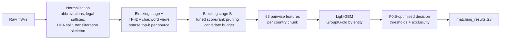

# Business Entity Resolution at Scale

An entity resolution pipeline that decides which business records from three independent, noisy sources refer to the same real-world business. It was built for the **Amazon ML Challenge 2026** (Business Entity Resolution) and runs on the full challenge data: **about 12M training records and 11.7M test records** across the US, India and an unseen country (France), with no common identifiers between sources.

> The competition dataset is not included (size and competition terms). `scripts/make_synthetic_data.py` generates data in the exact same format, so the whole pipeline can be run and scored locally.

## Problem

Source 1 is a deduplicated reference list. For every Source-1 business, find all matching records in Sources 2 and 3. Names contain abbreviations, legal-suffix changes, DBA names, typos and transliterations. Addresses are partial, reordered, or landmark-based ("Near SBI ATM"). An entity may have zero, one or many matches.

The metric is **macro F0.5** per Source-1 entity, which weights precision twice as much as recall. A correct "no match" for an entity with no true matches scores 1.0. A secondary goal is a **small candidate set** per entity, so blocking must scale without comparing every record to every other one.

## Approach



- **Normalisation** (`normalize.py`) is country-agnostic and rule-based only (no external lookups). It strips accents, canonicalises abbreviations (Corporation/Corp, Road/Rd, SARL/SAS/…), separates legal suffixes into a signature, splits DBA/AKA names into variants, and builds a phonetic "skeleton" that is robust to transliteration (Laxmi ≈ Lakshmi).
- **Blocking** (`blocking.py`) never compares all pairs:
  - Two L2-normalised TF-IDF views are used: character 3-grams of the name, and words of name plus address.
  - Multi-threaded sparse top-k products (`sparse_dot_topn`) retrieve neighbours per country and per source.
  - An exact cost model (Σ df_A·df_B) skips the most common n-grams for retrieval only when a product would be too expensive.
  - A pruning rule on combined score, forward rank and reverse rank is grid-searched on training labels, under a candidate-per-entity budget.
- **Features** (`features.py`) are all country-neutral:
  - TF-IDF cosines, rapidfuzz similarities, DBA-variant and acronym matches.
  - Legal-signature agreement, postal-code and house-number agreement, landmark flags.
  - Blocking ranks, and *group-relative margins* (how much better a pair is than the best competing candidate or competing entity).
  - Features are built one country at a time to bound memory.
- **Model and decision** (`matching.py`):
  - A LightGBM classifier trained with GroupKFold by entity.
  - The decision rule (global or per-source thresholds, expected-F0.5 set selection, with or without one-to-one exclusivity) is chosen by directly maximising out-of-fold macro F0.5.
- **Scale engineering.** Training uses an entity-cluster sample. Normalisation runs in parallel on unique strings, with lazy per-record details, and numpy group ranking replaces pandas. `predict_only.py` reruns inference from saved models and writes decision-threshold variants.

## Results

| Setting | Value |
|---|---|
| Out-of-fold macro F0.5 (10% training sample) | **0.977** (US 0.987, India 0.963), AUC 0.9999 |
| Blocking recall ceiling (train) / candidates per entity (test) | 0.974 / 16.2 |
| Public leaderboard macro F0.5 | **0.880** |
| Synthetic data (`scripts/`) | ~0.99+, a sanity check only |

### What the gap between validation and leaderboard taught me

The leaderboard score is well below validation. The main cause is **crowding shift**. For time and compute reasons, the model was trained on a 10% random entity sample, while the test set is about 8× more crowded with look-alike businesses. Denser neighbourhoods create more high-similarity near-duplicates, which means more false merges, and F0.5 penalises those most. The predicted *counts* matched reality well (5.5% empty entities vs 5.7% true, 3.30 vs 3.45 matches per entity), which points to precision on look-alikes as the problem, not recall. A lower retrieval cost cap used at test time to meet the deadline added a train/test mismatch in blocking.

**Next steps:**
1. **Sample training data by neighbourhood** (all records of randomly chosen postal codes or cities), so each entity sees its real competitors at small total cost.
2. **Validate on a crowding-matched holdout** before trusting any score.
3. **Keep blocking identical between training and test.**
4. **Add features that compare a pair directly against its nearest look-alike competitor.**

## Run it

```bash
pip install -r requirements.txt            # Python 3.9–3.12 (for 3.13, install the same packages unpinned)

python scripts/make_synthetic_data.py data_synth
python src/run_pipeline.py --data-dir data_synth --out-dir output --artifacts-dir artifacts
python scripts/score.py --pred output/matching_results.tsv --gt data_synth/test/test_ground_truth.tsv \
                        --cand output/candidate_pairs.tsv
```

On the real challenge data (4 CPUs / 31 GB), the submitted run was:

```bash
python src/run_pipeline.py --data-dir <dataset> --out-dir output \
    --train-frac 0.1 --k-per-view 12 --max-avg-cands 24 --folds 3 --n-jobs 4
python src/predict_only.py --data-dir <dataset> --models-dir artifacts --out-dir variants \
    --k-per-view 12 --n-jobs 4 --block-budget 1e10
```

Useful flags for `run_pipeline.py`:

| Flag | Effect |
|---|---|
| `--quick` | small training sample, fast smoke test |
| `--train-frac` | training sample fraction (default: test size / train size, capped by `--max-train-records`) |
| `--k-per-view`, `--max-avg-cands`, `--target-keep` | blocking breadth, candidate budget, recall target |
| `--block-budget` | per-product retrieval cost cap |
| `--loco` | leave-one-country-out diagnostic for unseen-country transfer |

## Repository layout

```
src/
  config.py            hyper-parameters
  normalize.py         name/address normalisation, transliteration skeleton
  data_io.py           TSV I/O, entity-cluster sampling, parallel normalisation, metric, validation
  blocking.py          cost-capped sparse top-k retrieval, pruning rule search
  features.py          63 pairwise features, per-country processing
  matching.py          LightGBM GroupKFold training, decision-rule search
  run_pipeline.py      end-to-end entry point
  predict_only.py      inference from saved models + threshold variants
  package_submission.py  builds the challenge submission zip
scripts/
  make_synthetic_data.py  challenge-format synthetic data (train: US/India, test adds France)
  score.py                macro F0.5 + blocking recall
docs/METHODOLOGY.md       full methodology write-up submitted with the solution
```

## Tech

Python · pandas · numpy/scipy sparse · scikit-learn (TF-IDF) · sparse_dot_topn · rapidfuzz · LightGBM. There are no pretrained models, no external data and no APIs. It runs on CPU only.

## License

MIT (see `LICENSE`).
